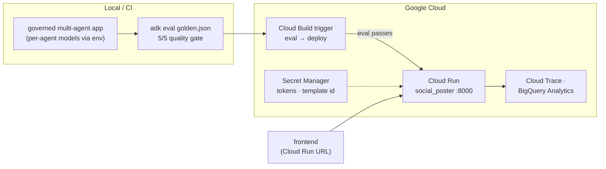

# Social Spark — Reference Implementation

**This is a reference, not a starting point.** Workshop 1 has you build a
smaller version of this agent yourself, step by step, in the
[codelab](docs/agentic-devcamp-workshop-1.html) — an orchestrator that
researches, drafts with Agent Skills, generates an image, and publishes
through Buffer or LinkedIn behind a human-approval gate, with a CopilotKit
web UI on top.

Consult this repo if you get stuck or want to see the fully governed,
production-tuned version further down the DevCamp road: guardrails
(Model Armor + DLP), a multi-agent split (research/draft/orchestrator),
per-agent model pinning, evals, and a Cloud Run deploy pipeline. It's the
finish line, not step 1 — don't `git clone` and run this instead of doing the
codelab.

## What's in here

**Per-agent model pinning, Cloud Run deployment with eval-gated CI/CD, and
observability** — tuned for production. This snapshot corresponds to the end
of the DevCamp series (Week 4 / "Optimise").



## What's new

### Per-agent model pinning (in code, live-verified)

Each agent's model is env-driven (`RESEARCH_MODEL`, `DRAFT_MODEL`,
`ORCHESTRATOR_MODEL`), defaulting to flash. The Week 4 experiment — drop
research + orchestrator to `flash-lite`, keep drafting on `flash` — runs
through the Week 3 eval set to check quality parity. **Update 2026-08-14: it
does not reliably hold** — two repeat runs on unchanged code scored 2/5 and
4/5, both times failing `on_brand_draft` (the drafted text itself, not the
tool-use process, misses the semantic bar). The all-flash baseline passes
clean 5/5 every time. See the 2026-08-14 LEARNINGS.md entry. That's still the
point of running evals instead of trusting vibes — just the opposite
conclusion from the original 2026-07-17 result: this cheaper mix costs real
quality, don't ship it without a fix.

```bash
# the cost-experiment mix (also in .env.example):
RESEARCH_MODEL=gemini-flash-lite-latest
ORCHESTRATOR_MODEL=gemini-flash-lite-latest
DRAFT_MODEL=gemini-flash-latest
```

### Deploy + observability (console/CLI guides)

```
docs/cloud-run-deploy.md    Dockerfile/cloudbuild.yaml → IAM → deploy → eval-gated CI/CD → the one real post
docs/observability.md       Cloud Trace slowest-span · BigQuery analytics agent
```

## Verify the model parity claim yourself

```bash
uv run python backend/mock_memory_agent.py   # separate terminal
# set the cost-experiment models in .env, then:
uv run adk eval backend/social_poster evals/golden.json \
  --config_file_path evals/eval_config.json
```

**As of 2026-08-14, expect flaky results (2-4 out of 5), not 5/5** — run it
live and show whatever it actually says; don't state parity as settled.

## What to verify (Week 4 slide material)

1. **Model parity**: run the eval on the cheaper mix (above) — as of
   2026-08-14 it's flaky (2-4/5, not the clean 5/5 first reported), which is
   itself the more honest demo: evals catching a real regression before a
   human reviewing drafts by eye necessarily would. Note the token/cost delta
   from the trace either way.
2. **Deploy**: [docs/cloud-run-deploy.md](docs/cloud-run-deploy.md) — ⏱ deploy
   time, IAM friction, prod end-to-end loop.
3. **Quality gate**: push a change, watch Cloud Build run eval → deploy. 📸
4. **Slowest span**: [docs/observability.md](docs/observability.md) — Cloud
   Trace waterfall. 📸
5. **The one real post** from prod, then flip `DRY_RUN=false → true`.
6. 📊 **ACTUAL total POC spend** — opens the Week 4 deck (slide 2).

## Notes

- Nothing about the app's *behaviour* changed this week — same governed
  multi-agent system as Week 3. Week 4 is packaging and tuning only, which is
  exactly why the Week 3 eval set is the right parity check.
- `DRY_RUN=true` stays the default everywhere, including deployed secrets.
