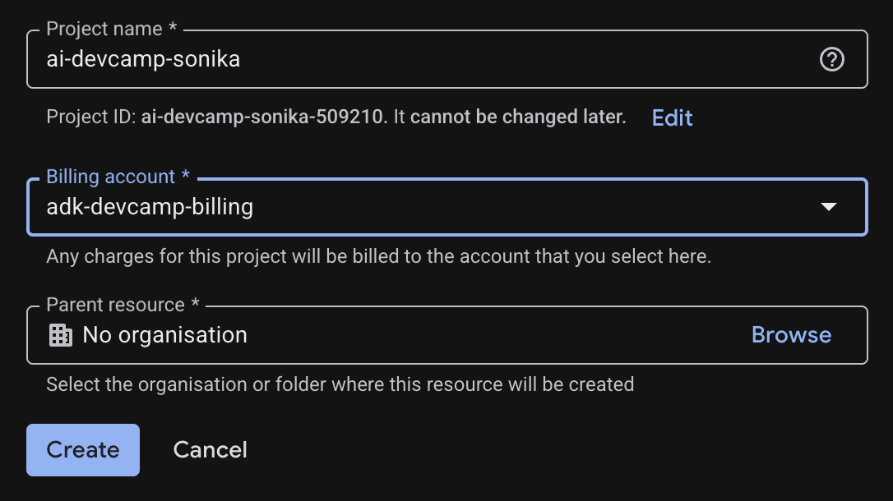
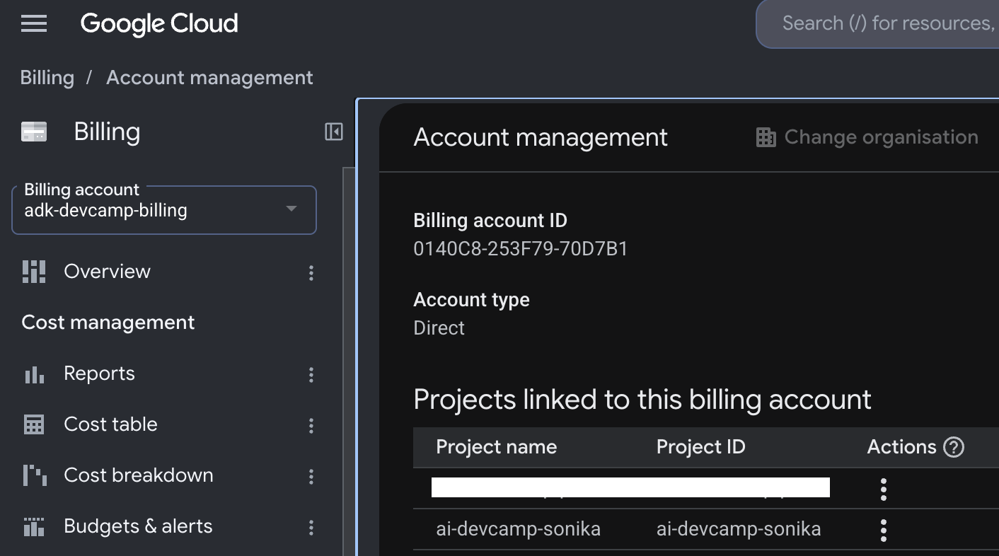
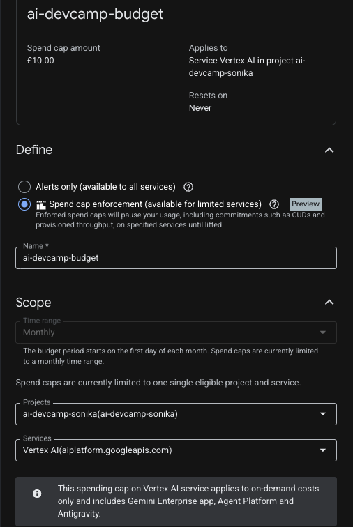
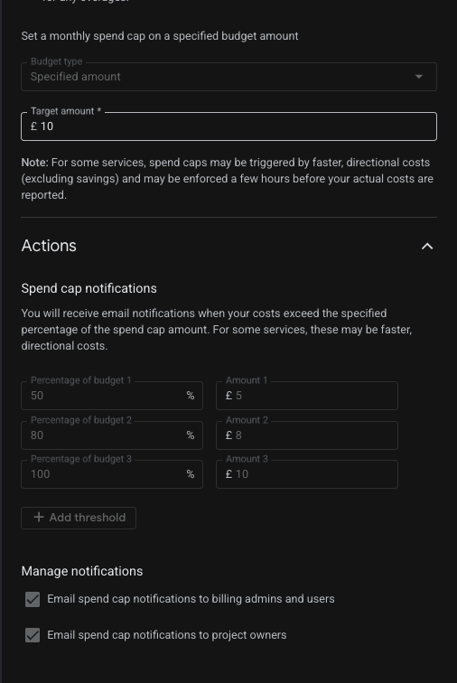
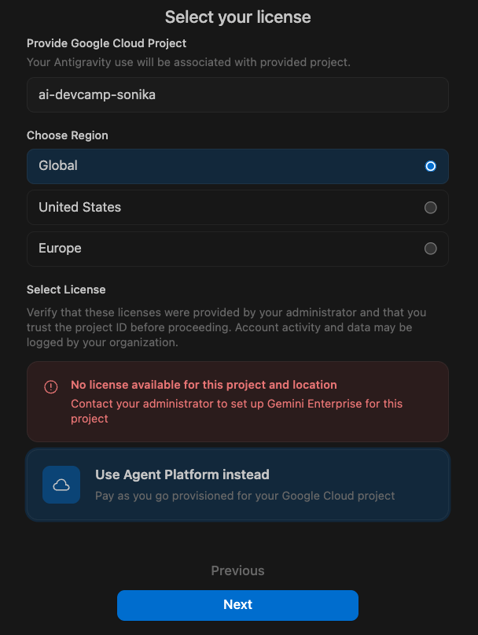
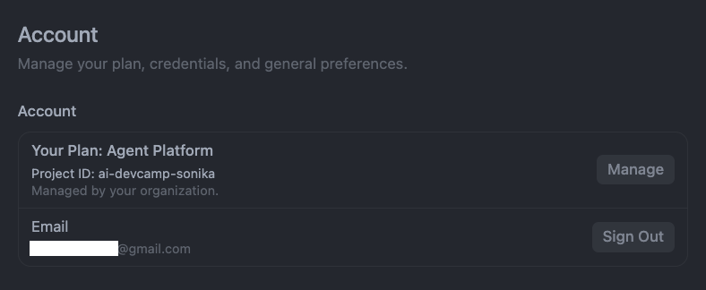

# AI DevCamp Pro: Agents — Pre-Camp Setup Guide
**Complete everything before Saturday 26 September.**

Setup takes 45 to 60 minutes across 4 guided phases. Do it early: the Discord #setup-help channel and your buddy group are there to unblock you before the first workshop. This guide is shared on 23 September, and any setup issues are discussed offline on Discord.


### The whole journey, in one picture

<svg viewBox="0 0 900 430" role="img" xmlns="http://www.w3.org/2000/svg"
     aria-label="Four pre-camp phases feeding into Lab 1. Phase 1 Cloud and budget foundation, Phase 2 Local developer tools, Phase 3 Coding agent setup, Phase 4 Environment and buddy check. These four are done before the camp; creating the agent project and running it happen in Lab 1 on the first Saturday."
     style="width:100%;height:auto;font-family:var(--font-body);">
  <defs>
    <marker id="su-arrow" viewBox="0 0 10 10" refX="9" refY="5" markerWidth="6" markerHeight="6" orient="auto-start-reverse">
      <path d="M0,0 L10,5 L0,10 z" fill="currentColor" opacity="0.45"/>
    </marker>
  </defs>

  <text x="0" y="16" font-size="12.5" font-weight="700" fill="currentColor" opacity="0.55" letter-spacing="0.06em">BEFORE THE CAMP — THIS GUIDE</text>

  <!-- Phase 1 -->
  <rect x="0" y="30" width="210" height="150" rx="12" fill="#34a853" opacity="0.10"/>
  <rect x="0" y="30" width="4" height="150" rx="2" fill="#34a853"/>
  <circle cx="26" cy="56" r="11" fill="#34a853"/>
  <text x="26" y="60" font-size="12" font-weight="700" fill="#fff" text-anchor="middle">1</text>
  <text x="46" y="54" font-size="13" font-weight="700" fill="currentColor">Cloud &amp; budget</text>
  <text x="46" y="70" font-size="13" font-weight="700" fill="currentColor">foundation</text>
  <text x="16" y="96" font-size="11.5" fill="currentColor" opacity="0.72">Google account</text>
  <text x="16" y="114" font-size="11.5" fill="currentColor" opacity="0.72">GCP project + $300 credit</text>
  <text x="16" y="132" font-size="11.5" fill="currentColor" opacity="0.72">Spend cap &amp; budget alert</text>
  <text x="16" y="150" font-size="11.5" fill="currentColor" opacity="0.72">Enable the APIs</text>
  <text x="16" y="170" font-size="10.5" fill="currentColor" opacity="0.45">⏱ 20 min</text>

  <!-- Phase 2 -->
  <rect x="230" y="30" width="210" height="150" rx="12" fill="#1a73e8" opacity="0.10"/>
  <rect x="230" y="30" width="4" height="150" rx="2" fill="#1a73e8"/>
  <circle cx="256" cy="56" r="11" fill="#1a73e8"/>
  <text x="256" y="60" font-size="12" font-weight="700" fill="#fff" text-anchor="middle">2</text>
  <text x="276" y="54" font-size="13" font-weight="700" fill="currentColor">Local developer</text>
  <text x="276" y="70" font-size="13" font-weight="700" fill="currentColor">tools</text>
  <text x="246" y="96" font-size="11.5" fill="currentColor" opacity="0.72">Python 3.12+, uv, Node</text>
  <text x="246" y="114" font-size="11.5" fill="currentColor" opacity="0.72">gcloud → us-central1</text>
  <text x="246" y="132" font-size="11.5" fill="currentColor" opacity="0.72">Authenticate (ADC)</text>
  <text x="246" y="150" font-size="11.5" fill="currentColor" opacity="0.72">Install ADK</text>
  <text x="246" y="170" font-size="10.5" fill="currentColor" opacity="0.45">⏱ 15 min</text>

  <!-- Phase 3 -->
  <rect x="460" y="30" width="210" height="150" rx="12" fill="#a142f4" opacity="0.10"/>
  <rect x="460" y="30" width="4" height="150" rx="2" fill="#a142f4"/>
  <circle cx="486" cy="56" r="11" fill="#a142f4"/>
  <text x="486" y="60" font-size="12" font-weight="700" fill="#fff" text-anchor="middle">3</text>
  <text x="506" y="54" font-size="13" font-weight="700" fill="currentColor">Coding agent</text>
  <text x="506" y="70" font-size="13" font-weight="700" fill="currentColor">superpowers</text>
  <text x="476" y="96" font-size="11.5" fill="currentColor" opacity="0.72">Antigravity (or Claude</text>
  <text x="476" y="114" font-size="11.5" fill="currentColor" opacity="0.72">Code / Gemini CLI)</text>
  <text x="476" y="132" font-size="11.5" fill="currentColor" opacity="0.72">Vertex AI fallback</text>
  <text x="476" y="150" font-size="11.5" fill="currentColor" opacity="0.72">agents-cli + ADK skills</text>
  <text x="476" y="170" font-size="10.5" fill="currentColor" opacity="0.45">⏱ 10 min</text>

  <!-- Phase 4 -->
  <rect x="690" y="30" width="210" height="150" rx="12" fill="#f9ab00" opacity="0.12"/>
  <rect x="690" y="30" width="4" height="150" rx="2" fill="#f9ab00"/>
  <circle cx="716" cy="56" r="11" fill="#f9ab00"/>
  <text x="716" y="60" font-size="12" font-weight="700" fill="#fff" text-anchor="middle">4</text>
  <text x="736" y="54" font-size="13" font-weight="700" fill="currentColor">Environment &amp;</text>
  <text x="736" y="70" font-size="13" font-weight="700" fill="currentColor">camp readiness</text>
  <text x="706" y="96" font-size="11.5" fill="currentColor" opacity="0.72">Know your .env values</text>
  <text x="706" y="114" font-size="11.5" fill="currentColor" opacity="0.72">Buddy check</text>
  <text x="706" y="132" font-size="11.5" fill="currentColor" opacity="0.72">Buffer account</text>
  <text x="706" y="170" font-size="10.5" fill="currentColor" opacity="0.45">⏱ 10 min</text>

  <!-- connectors -->
  <line x1="212" y1="105" x2="226" y2="105" stroke="currentColor" stroke-width="1.6" opacity="0.45" marker-end="url(#su-arrow)"/>
  <line x1="442" y1="105" x2="456" y2="105" stroke="currentColor" stroke-width="1.6" opacity="0.45" marker-end="url(#su-arrow)"/>
  <line x1="672" y1="105" x2="686" y2="105" stroke="currentColor" stroke-width="1.6" opacity="0.45" marker-end="url(#su-arrow)"/>
  <path d="M450,190 L450,232" stroke="currentColor" stroke-width="1.6" opacity="0.45" fill="none" marker-end="url(#su-arrow)"/>

  <text x="0" y="262" font-size="12.5" font-weight="700" fill="currentColor" opacity="0.55" letter-spacing="0.06em">FIRST SATURDAY — THE WORKSHOP</text>

  <!-- Lab 1 -->
  <rect x="0" y="276" width="900" height="140" rx="12" fill="none" stroke="currentColor" stroke-opacity="0.28" stroke-width="1.4" stroke-dasharray="5 4"/>
  <text x="20" y="302" font-size="13" font-weight="700" fill="currentColor">Lab 1 — Build</text>
  <text x="20" y="320" font-size="11.5" fill="currentColor" opacity="0.6">Nothing to do about these now. They are the workshop.</text>

  <rect x="20" y="334" width="420" height="64" rx="10" fill="currentColor" opacity="0.055"/>
  <text x="38" y="356" font-size="12.5" font-weight="700" fill="currentColor">Create the agent project</text>
  <text x="38" y="376" font-size="11.5" fill="currentColor" opacity="0.72">Clone the starter repo — agent.py is deliberately empty,</text>
  <text x="38" y="391" font-size="11.5" fill="currentColor" opacity="0.72">and everything agent-shaped is yours to write.</text>

  <rect x="460" y="334" width="420" height="64" rx="10" fill="currentColor" opacity="0.055"/>
  <text x="478" y="356" font-size="12.5" font-weight="700" fill="currentColor">Run &amp; test it locally</text>
  <text x="478" y="376" font-size="11.5" fill="currentColor" opacity="0.72">adk web, the CopilotKit UI, a real draft, your approval,</text>
  <text x="478" y="391" font-size="11.5" fill="currentColor" opacity="0.72">and a post that actually publishes.</text>
</svg>

**Four phases before the camp, then the workshop.** Everything in this guide is
the four boxes on top — account, tools, coding agent, environment. Building the
agent and running it happen on the first Saturday, in Lab 1. If you finish the
four phases, you are ready.

### What you're setting up across 4 phases
- 🟢 **Phase 1: Cloud & Budget Foundation** — *step 2️⃣* (GCP account & project, $300 credit, spend cap)
- 🔵 **Phase 2: Local Developer Tools** — *steps 1️⃣ & 4️⃣* (Python 3.12+, uv, gcloud configured to `us-central1`, 1-command API enablement, ADK)
- 🟣 **Phase 3: Coding Agent Setup & ADK Superpowers** — *also step 1️⃣* (Antigravity with Vertex AI fallback & ADK skills)
- 🟡 **Phase 4: Environment, Buddy Check & Camp Readiness** — *step 5️⃣, the values* (.env check, buddy swap, Buffer account)

## Important notes before you start
- **Cost:** the whole camp is designed to fit well inside Google's $300 free trial credit (90 days). You'll set a real spend cap (not just an email alert) in Phase 1 so nothing surprises you.
- **Card required:** Google asks for a credit/debit card to verify identity when you start the free trial. You are not charged during the trial, and it does not auto-charge when the trial ends without you upgrading.
- **The $300 credit covers Vertex AI, not the separate Gemini API / AI Studio billing system.** All model calls in this camp (including image generation) go through **Vertex AI inside your GCP project**, so they're covered. If you ever grab a standalone API key from aistudio.google.com, that's a different account with its own billing (Google is moving it to a mandatory prepaid balance from September 2026); don't put a card on that one.
- **Your coding agent, your account:** you'll code with Google Antigravity by default (Claude Code or Gemini CLI also work; the labs give you prompts and checkpoints, not code). Any AI IDE accounts, quotas, or subscriptions are your own responsibility; the camp only uses your GCP credit for cloud resources.
- **Windows users:** you'll need WSL 2 (Windows Subsystem for Linux). Open PowerShell as Administrator, run `wsl --install`, restart your computer, then launch the **Ubuntu** terminal. Run all subsequent commands in this guide inside that Ubuntu terminal.

> [!IMPORTANT]
> **No Service Account Keys Needed**: DevCamp uses Application Default Credentials (`gcloud auth application-default login`) and IAM impersonation. You will never need to create, download, or manage sensitive `.json` key files.

## 🟢 Phase 1: Cloud & Budget Foundation ⏱ 20 min
*Goal: Create your GCP project and configure a spend cap so you can never be unexpectedly billed.*

1. Go to [cloud.google.com/free](https://cloud.google.com/free) and start the free trial with a Google account (a personal Gmail is fine; work accounts often have restrictions, avoid them).
2. In the top navbar project dropdown → Click **"New Project"** to create a project named `ai-devcamp-<yourname>`.
   *(Leave "Location" as "No organization" if prompted — in Google Cloud, projects themselves are global metadata containers, so you will not see a geographical region selector here).*

   

3. Verify your billing account is linked to your new project (console → **Billing → My Projects**).

   

4. Enable the required APIs (Vertex AI API, Cloud Run, Cloud Build, Sensitive Data Protection, Model Armor, Discovery Engine, Cloud Resource Manager API, App Hub API). You can search for them in the console (**APIs & Services → Enable APIs and Services**), or run the one-line `gcloud` command in Phase 2 right after installing `gcloud`.

5. **Set a spend cap** (console → **Billing → Budgets & alerts**): create a budget scoped to your `ai-devcamp-<yourname>` project, alert thresholds at 50/80/100%, **and** turn on the spend-cap option scoped to the Vertex AI / Gemini API service (currently in preview). Unlike a plain alert, the spend cap actually pauses further Vertex AI usage once you hit 100%. A plain email alert doesn't stop anything.

    

🏁 **Phase 1 Checkpoint:** The Vertex AI page in the console loads without an "enable API" prompt, and Budgets & alerts shows your budget with the spend cap enabled.

## 🔵 Phase 2: Local Developer Tools ⏱ 15 min
*Goal: Get your command line talking to Google Cloud, configure your default deployment region, and install ADK development tools.*

Install, in order:
1. **Python 3.12+** (python.org or your package manager; the project requires 3.12)
2. **uv** (Python package manager): `curl -LsSf https://astral.sh/uv/install.sh | sh`
3. **Node.js 20+** (nodejs.org)
4. **Google Cloud SDK** (cloud.google.com/sdk), then in your terminal:
   ```bash
   gcloud auth login
   gcloud auth application-default login
   gcloud config set project ai-devcamp-<yourname>
   gcloud config set compute/region us-central1

   # Enable all required APIs in one command:
   gcloud services enable \
     aiplatform.googleapis.com \
     run.googleapis.com \
     cloudbuild.googleapis.com \
     dlp.googleapis.com \
     modelarmor.googleapis.com \
     discoveryengine.googleapis.com \
     cloudresourcemanager.googleapis.com \
     apphub.googleapis.com
   ```
> [!NOTE]
> **Why us-central1?** In Google Cloud, regions are selected when deploying individual services, not when creating the project. All workshops in this camp deploy resources to `us-central1`. The Semantic Governance Policy Engine (used in Session 3, Govern) currently exists **only in us-central1** (verified directly: `global` and `europe-west2` both return *"The Semantic Governance Policy Engine service is not available in location X"*). Furthermore, a Governance Policy binds to an Agent Registry entry in whatever region the engine was deployed to. Setting `us-central1` here ensures your agent deployments will be able to attach governance policies in Session 3 without redeploying.

5. **ADK**: `uv tool install google-adk` (or `pip install google-adk`)
6. **Git** + a **GitHub account**. In Lab 1 you'll clone the starter repo: the web frontend, the LinkedIn MCP server and the Agent Skills come prebuilt; you build the agent backend.

🏁 **Phase 2 Checkpoint:** `adk --version`, `node --version`, and `gcloud config get-value project` all return sensible answers.

## 🟣 Phase 3: Coding Agent Setup & ADK Superpowers ⏱ 10 min
*Goal: Set up Google Antigravity with your Google Cloud Vertex AI project budget and install ADK skills.*

1. **Download & Launch Google Antigravity**.
2. **Sign in using the Business Account (Google Cloud Project) Pathway**:
   - **Select the Business Pathway**: When logging in (or logging back in if previously signed in with a personal/Pro account), do **not** select "Continue with Google". Instead, choose **Business Account** (or click the option that says *"Use Google Cloud project instead"* or *"Continue with Google Cloud"*).
   - **Authenticate**: Even though it says "Business", your browser will open to Google's standard sign-in screen. Log in using your personal Gmail account (or whichever Google account owns your `ai-devcamp-<yourname>` Google Cloud project).
   - **Link Your Project and Budget**: After authenticating, the IDE extension will prompt you for configuration fields:
     - **Google Cloud Project ID**: Enter `ai-devcamp-<yourname>` (the project ID where your Vertex AI budget is housed).
     - **Location**: Set location to `Global`.
     - **Select License / Agent Platform**: If a message appears saying *"No license available for this project and location"*, click **"Use Agent Platform instead — Pay as you go provisioned for your Google Cloud project"**.

     

   - **Verify Account Tier**: Once linked, open **Account Settings**. Your plan inside Antigravity will display **Your Plan: Agent Platform** (Pay-As-You-Go) linked to your Project ID and Gmail account. All token consumption and model calls generated by your IDE interactions will be billed directly to the budget linked to your Google Cloud project.

     

> [!WARNING]
> **Troubleshooting — Agent Platform / Vertex AI API Error**:
> If you encounter the following error when authenticating or calling models in Antigravity:
> ```
> Agent Platform API has not been used in project ai-devcamp-<yourname> before or it is disabled. Enable it by visiting https://console.developers.google.com/apis/api/aiplatform.googleapis.com/overview?project=ai-devcamp-<yourname> then retry. If you enabled this API recently, wait a few minutes for the action to propagate to our systems and retry.
> ```
> **Fix**: Click the link provided in the error message (`https://console.developers.google.com/apis/api/aiplatform.googleapis.com/overview?project=ai-devcamp-<yourname>`) to enable the **Vertex AI / Agent Platform API** (`aiplatform.googleapis.com`), or run `gcloud services enable aiplatform.googleapis.com` in your terminal. Wait 2–3 minutes for propagation and retry.
>
> **IAM Permissions**: Ensure your Google account has the **Vertex AI User** (`roles/aiplatform.user`), **Owner**, or **Editor** role on your GCP project.

3. Optional second backup: a **free-tier** key from aistudio.google.com (no card, no billing setup). It's rate-limited but enough to get through a stall, and it's separate from your $300 credit. Do **not** enable Prepay/billing on that account.
4. Prefer another coding agent (Claude Code, Gemini CLI)? Fine. The labs give you the prompt to type and the result to check, not the code, so any agent works.
5. **Teach your coding agent about ADK** — one command, worth more than it looks:
   ```bash
   uvx google-agents-cli setup
   ```
   This installs Google's `agents-cli` **and** detects which coding agents you
   have (Antigravity, Claude Code, Cursor, Windsurf…), then installs a set of
   ADK development skills into each one. Every lab works by you prompting your
   coding agent to build something — this is what makes its answers actually
   match current ADK, instead of whatever its training data remembers. Add
   `--dry-run` first if you'd like to see what it would change before it does,
   or `--workspace` to install into the project folder rather than globally.

   > These are skills for the *AI that writes your code*. They're a different
   > thing from the **Agent Skills** in the starter repo's `skills/` folder,
   > which are instructions your *agent* loads at runtime — you'll build with
   > those in Lab 1.

🏁 **Phase 3 Checkpoint:**
- Antigravity displays your account tier as **Business (Pay-As-You-Go)**.
- Ask Antigravity to create a hello-world Python file; review its plan, accept, run it.
- `agents-cli --version` returns a version. Open Antigravity's chat panel and type: *"What ADK skills do you have?"* It should list several `google-agents-cli-*` entries (like `adk-code`, `adk-dev-guide`, etc.).

## 🟡 Phase 4: Environment, Buddy Check & Camp Readiness ⏱ 10 min
*Goal: Confirm your environment variables, verify setup with your buddy, and prep social tools.*

### 1. Environment variables

> [!NOTE]
> **You can't create this file yet, and you don't need to.** It lives at
> `backend/social_poster/.env` inside the repo you clone in Lab 1, so the folder
> doesn't exist until the workshop starts. Lab 1 Step 1 walks you through
> copying `.env.example` into place. What matters *now* is knowing these four
> values and why they're what they are — especially `GOOGLE_CLOUD_LOCATION`,
> which is the single most common cause of a 404 on the first model call.

These are the values you'll put in it (this is step 5️⃣ of the diagram above):
```
GOOGLE_GENAI_USE_VERTEXAI=TRUE
GOOGLE_CLOUD_PROJECT=ai-devcamp-<yourname>
GOOGLE_CLOUD_LOCATION=global
DRY_RUN=true
```
(`DRY_RUN=true` means the LinkedIn posting tool logs posts instead of publishing. Nobody posts anything by accident in this camp.)

> [!NOTE]
> **`GOOGLE_CLOUD_LOCATION=global`**: Always use `global` for your Gemini flash model calls in Vertex AI. Regional endpoints (like `europe-west1`) do not yet serve `gemini-flash-latest` and will return 404 errors.

**Use `global`, not a regional endpoint, here — confirmed by direct testing, not assumption.** `gemini-flash-latest` returns a 404 "Publisher model not found" in `europe-west1` (and in `europe-west2`, hit the same way during Scale deploy testing): regional Vertex AI endpoints can lag behind `global` for the newest flash models. `global` is the one location confirmed to actually serve `gemini-flash-latest`. This is unrelated to Phase 1's project region (`us-central1` is used there for Agent Runtime and Governance Policies — that's separate from the model call's location) and to Model Armor's region in Session 3 (Model Armor specifically needs a real region, `global` doesn't work for *that* call — the two settings are independent, don't conflate them).

### 2. Buddy check
You'll be placed in a small buddy group in Discord before the first workshop. Before Saturday, post your checkpoint results from Phases 1–3 in your group thread and confirm one buddy's results in return. Broken setups get fixed in the group or on Discord, not during the workshop.

### 3. Recommended before Saturday
- **Buffer account:** Lab 1 publishes through Buffer's MCP server. Create a free Buffer account and connect at least one channel (a LinkedIn profile is fine). No card needed for the free tier. You'll grab the API key during the lab.
- **LinkedIn Developer app** (optional bonus step in Lab 1; everything else works through Buffer or in dry-run): skip for now if short on time, a guide is linked from the lab.
- **GCS image hosting for Buffer** (optional, advanced — not part of Lab 1's taught steps, which keep Buffer text-only by design; only relevant if you want Buffer posts to carry an image like the reference build does): needs a one-time IAM setup outside the app's own reach — a dedicated service account, granted signing rights via impersonation rather than a downloaded key. Set `GOOGLE_CLOUD_PROJECT`/`GCS_BUCKET_NAME` in your `.env`, then run `./gcs-setup.sh` from the repo root — it does the IAM setup and updates your `.env` for you (see `.env.example`'s GCS section for what it does). Skip this entirely unless you're specifically extending past Lab 1.
- Join the **GDG London Discord** ([discord.gg/952SuUXME](https://discord.gg/952SuUXME)) and say hi in #introductions. Channels: #setup-help, #session-1 to #session-4, #show-your-use-case.
- Think of **one use case of your own**: an agent you'd like to exist. You'll declare it in Lab 1 and build it alongside ours as each lab's Assignment.

🏁 **Phase 4 Checkpoint:** `uv run adk web` against any agent and send one message — a 404 "Publisher model ... was not found" means `GOOGLE_CLOUD_LOCATION` is still set to a region, not `global`.


## The running use case you'll build
An agent that turns your idea into a formatted social post: it researches the web, drafts with Agent Skills, generates an image, waits for your approval in a proper web UI, and publishes via MCP. Built in Lab 1, made production-ready across Labs 2 to 4.

## Schedule
| Session | Thursday (theory, 1hr) | Saturday (workshop, 2hr) | Pillar |
|---|---|---|---|
| Kickoff | 23 Sept, 6–9pm, hybrid: Skyscanner + online | — | Series overview + trends |
| 1 | 24 Sept | 26 Sept | Build |
| 2 | 1 Oct | 3 Oct | Scale |
| 3 | 8 Oct | 10 Oct | Govern |
| 4 | 15 Oct | 17 Oct | Optimise |

## If something breaks
1. Ask your buddy group, then search #setup-help; someone has probably hit it.
2. Post: your OS, the exact command, the exact error.
3. Still stuck on Saturday? Pair with a buddy; broken environments follow along on the instructor project and fix after.

